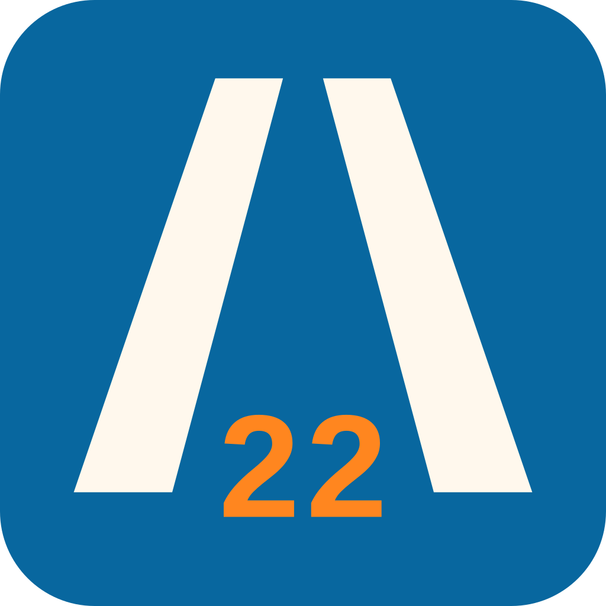

# A22R

<p align="center">
  
</p>


**A22R** is a local repository for personal information and the links between
records—for example, email addresses, phone numbers, accounts, services, and
other objects.

The application helps you see relationships, keep track of dates and timers,
and assemble a compact one-sheet **hardcopy** for use without a phone or
internet access. The objects and scenarios listed here are examples and do not
limit the ways the application can be used.

This is not a password manager or a vault. Important passwords are not intended
to be stored here; use owner-specific hints instead. Full passwords are
acceptable only for low-importance registrations.

## Status and technology

The project is actively evolving. The current version already provides a
working application foundation, but gaps remain in the visual design, UI Kit,
and some functional areas—for example, interval timer management. These parts
are being developed further.

A22R is a native desktop application built to explore Rust, GPUI, and GPUI Kit.
The presentation layer is built with GPUI, while reusable interface components
are developed on top of GPUI Kit. The application services, domain logic, and
data storage are also implemented in Rust.

## Overview

The native workspace combines record browsing, tag filtering, record details,
and relationship exploration in one GPUI window.

The visual design is not finished yet: the current build needs further layout
and interface work. Even at this stage, the native structure and interaction
model provide a working basis for exploring the application.

## Simple and flexible by design

A22R does not impose a fixed vocabulary or rigid record schema. Users can name
records, information fields, relationships, and tags in the way that fits
their own system. The built-in examples and suggestions are starting points,
not rules: one workspace can describe people, accounts, devices, services,
documents, or any combination of them.


*Figure 1. Workspace with a tag filter, ordered record list, and selected
record details.*


*Figure 2. The selected record's direct neighbors with typed relationships.*

The debug-only Inspector exposes native element properties and the component
tree without changing the production UI. It has also been substantially
reworked for practical use: before that work, the Inspector was nearly
unusable, while the current version makes the native UI structure much easier
to inspect and navigate.


*Figure 3. Workspace element properties shown in the Inspector.*


*Figure 4. The current-frame component tree with source, hierarchy, and bounds.*

The reusable A22R UI Kit showcase presents shared visual tokens and controls in
both supported color modes.


*Figure 5. Dark UI Kit tokens, buttons, selection controls, and feedback
states.*


*Figure 6. Light UI Kit autocomplete, multi-select tags, selects, and list
rows.*


*Figure 7. Base report window shown alongside the item workspace and
relationship graph.*

## What is included

The current first-version slice includes, among other things:

- record creation, viewing, editing, and deletion, with unsaved-change guards;
- ordered information fields, primary values, dates, and tags;
- case-insensitive search, filters for all selected tags, suggestions, and
  sorting;
- directed relationship editing and the relationship graph view;
- base reports with grouping, pagination, relationship labels, and PDF output;
- JSON import, JSON export, and pre-import snapshots;
- preservation of timers, timer links, relationships, and snapshots even where
  complete timer management is deferred;
- a native UI Kit showcase;
- debug-only [A22R Inspector](docs/inspector/README.md) tooling.

JSON v1 is accepted only on import. Export always writes JSON v2 with its
current checksum contract.

## Architecture

```text
a22-app -> a22-ui -> a22-application -> a22-core -> a22-db
    \-> a22-platform
```

- `a22-app`: native GPUI startup, main window, menus, and window registries;
- `a22-ui`: A22-owned views, widgets, drafts, and report presentation;
- `a22-application`: typed commands, structured errors, snapshots, and the
  serialized worker owning `AppState`;
- `a22-core`: domain rules, normalization, search, timers, import/export, and
  reports;
- `a22-db`: SQLite schema, migrations, ordering, links, timers, and snapshots;
- `a22-platform`: native dialogs, filesystem, clipboard, data paths, settings,
  and the PDF adapter;
- `a22-ui-kit-gpui`: reusable controls based on the pinned GPUI Kit family.

The UI never accesses SQLite or performs blocking I/O from a render method. The
root `Cargo.lock` is authoritative, and local GPUI source forks are kept only
for the narrow Inspector integration.

## Requirements

### macOS development baseline

- macOS Ventura 13.5 or newer;
- Xcode 15.2 and matching Command Line Tools;
- Rustup with Rust `1.99.1`;
- Git.

Install or select the pinned toolchain:

```bash
rustup toolchain install 1.99.1
rustup show active-toolchain
xcode-select --install
```

### Windows candidate baseline

The candidate target is x86_64 Windows 10 22H2 or newer and Windows 11 with:

- Rust `1.99.1` MSVC toolchain;
- Visual Studio 2022 Build Tools or Community with C++, MSVC, and the Windows
  SDK;
- CMake on `PATH`;
- Developer PowerShell for VS 2022.

Windows build, launch, persistence, packaging, Accessibility, and native E2E
verification are still pending on a real Windows machine. Do not treat a
cross-target check on macOS as Windows support verification.

## Run the application

From the repository root:

```bash
cargo +1.99.1 run -p a22-app --locked
```

The debug application opens the native record workspace. The first build may
take several minutes while GPUI and the pinned GPUI Kit family compile.

The Inspector is available only in debug builds and is closed by default:

- `Cmd+Option+Shift+I` toggles the detached Inspector;
- `Cmd+Option+Shift+T` toggles the component tree;
- toolbar buttons provide the same actions.

See [Inspector development tooling](docs/inspector/README.md) for its
architecture and native smoke command.

## Build and package

Debug binary:

```bash
cargo +1.99.1 build -p a22-app --locked
```

Release binary:

```bash
cargo +1.99.1 build -p a22-app --release --locked
```

Release builds intentionally do not include the debug-only Inspector.

Build the macOS application bundle and disk image:

```bash
./scripts/build-macos-app.sh
./scripts/build-macos-dmg.sh
```

Outputs:

```text
target/release/A22R.app
target/release/A22R.dmg
```

Build the Windows package from Developer PowerShell on Windows:

```powershell
.\scripts\build-windows-app.ps1
```

The expected outputs are `target\windows\A22R\A22R.exe` and the accompanying
x86_64 ZIP archive. The script still requires native Windows verification.

## Verify

Standard Rust quality gates:

```bash
cargo +1.99.1 fmt --all -- --check
cargo +1.99.1 metadata --no-deps --locked
cargo +1.99.1 check --workspace --all-targets --locked
cargo +1.99.1 clippy --workspace --all-targets --all-features --locked -- -D warnings
cargo +1.99.1 test --workspace --locked
cargo +1.99.1 build --workspace --release --locked
```

The ordinary workspace test command does not open native windows. Native E2E
is ignored by default and requires a logged-in desktop session plus platform
Accessibility permission:

```bash
cargo +1.99.1 test -p a22-app --test native_e2e --locked -- \
  --ignored --nocapture --test-threads=1
```

The native suite uses an isolated temporary SQLite profile. It covers
Accessibility smoke, record guards, delete confirmation, import/export, search
and filtering, autocomplete, tags, and relationship lifecycle.

For a visible serialized native run:

```bash
A22R_E2E_DEMO=1 A22R_E2E_DEMO_DELAY_MS=1000 \
cargo +1.99.1 test -p a22-app --test native_e2e --locked -- \
  --ignored --nocapture --test-threads=1
```

## Data and reset

Application data is stored at:

- macOS: `~/Library/Application Support/A22R/a22r.sqlite3`;
- Windows: `%LOCALAPPDATA%\A22R\a22r.sqlite3`;
- Linux: `$XDG_DATA_HOME/A22R/a22r.sqlite3` or
`~/.local/share/A22R/a22r.sqlite3`.

To reset the macOS development profile, close A22R and run:

```bash
rm -f \
  "$HOME/Library/Application Support/A22R/a22r.sqlite3" \
  "$HOME/Library/Application Support/A22R/a22r.sqlite3-wal" \
  "$HOME/Library/Application Support/A22R/a22r.sqlite3-shm"
```

The next launch creates a new empty profile. This permanently removes local
records, timers, relationships, and saved snapshots.

## Current limitations

- Record and outgoing-relationship persistence is not yet one SQLite
  transaction; the risk and follow-up are recorded in [technical
  debt](docs/tech-debt.md).
- Full timer-management UI, including interval-based scenarios, is deferred,
  but timer data is preserved.
- The visual design and UI Kit are still evolving; some advanced graph and
  report interactions are not yet complete.
- System printing and some advanced report scenarios remain deferred.
- VoiceOver and native Accessibility coverage is incomplete.
- Windows remains an unverified candidate target.

## Documentation

- [Current architecture](docs/01-current-architecture.md)
- [UI requirements and parity scope](docs/02-ui-requirements-and-parity.md)
- [Target architecture and invariants](docs/03-target-architecture.md)
- [Database and file contract](docs/db-design.md)
- [Testing and verification](docs/06-testing-tools.md)
- [Version and platform baseline](docs/07-version-baseline.md)
- [UI Kit showcase](docs/ui-kit-showcase.md)
- [GPUI fork maintenance](forks/gpui-kit/README.md)
- [Inspector implementation](docs/inspector/README.md)
- [Initial release follow-up](docs/plans/00-initial-release_plan.md)
- [Changes](docs/changes.md)

## Licenses

The application is licensed under the MIT license in [LICENSE](LICENSE).
Bundled Onest and Roboto Flex fonts retain their SIL Open Font License 1.1
notices under [`docs/licenses`](docs/licenses).
