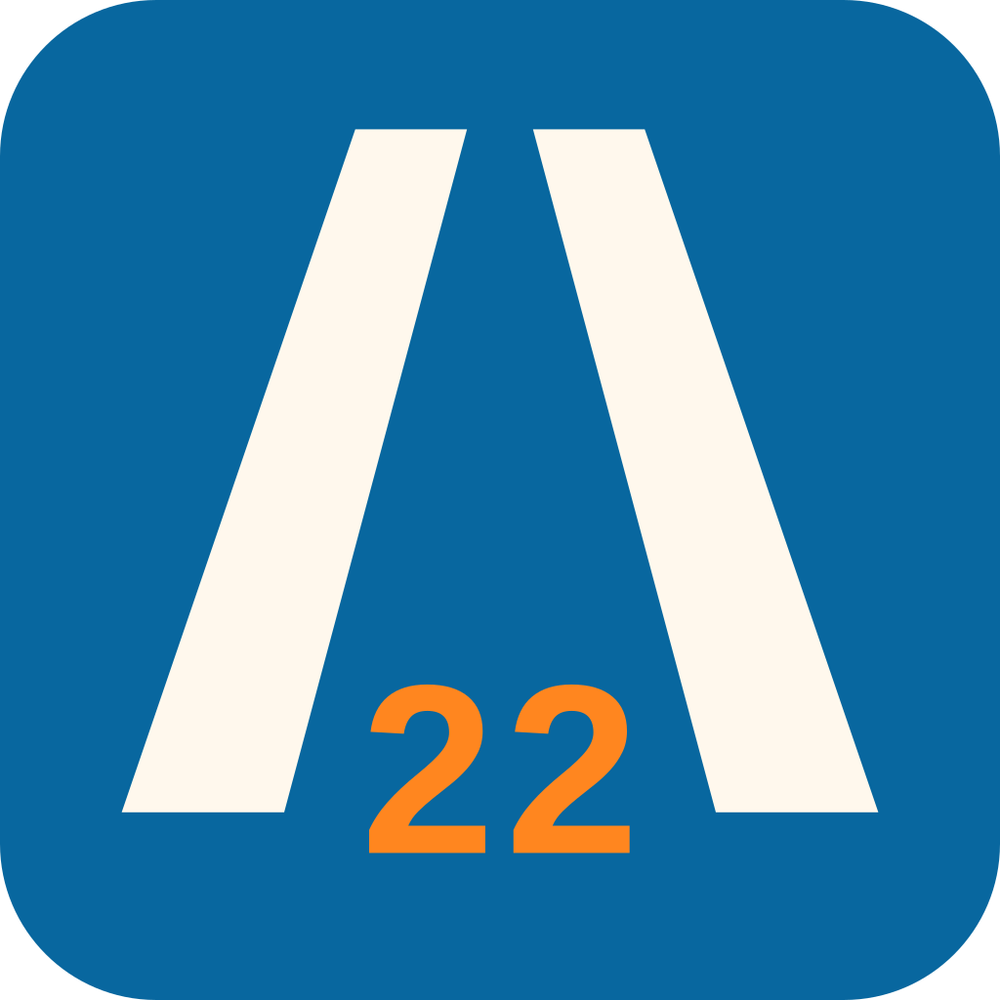

# A22R

<p align="center">
  
</p>

**A22R** — локальное хранилище личной информации и связей между записями:
например, адресами электронной почты, номерами телефонов, аккаунтами,
сервисами и другими объектами.

Приложение помогает видеть взаимосвязи, учитывать даты и таймеры и собирать
компактную однолистную **хардкопию** для использования без телефона и
интернета. Перечисленные объекты и сценарии — лишь примеры и не ограничивают
способы использования приложения.

Это не менеджер паролей и не сейф. Важные пароли здесь не предполагаются;
вместо них можно сохранять понятные владельцу подсказки. Полные пароли
допустимы только для неважных регистраций.

## Статус и технологическая основа

Проект активно развивается. Текущая версия уже содержит рабочую основу
приложения, но в ней остаются пробелы в визуальном дизайне, UI Kit и отдельных
функциональных областях — например, в управлении интервальными таймерами. Эти
части постепенно дорабатываются.

A22R — нативное desktop-приложение, созданное для исследования Rust, GPUI и
GPUI Kit. Презентационный слой построен на GPUI, а переиспользуемые элементы
интерфейса развиваются на базе GPUI Kit. Сервисы приложения, доменная логика и
хранение данных также реализованы на Rust.

## Обзор

Нативное рабочее пространство объединяет просмотр записей, фильтрацию по
меткам, подробности записи и исследование связей в одном окне GPUI.

Визуальный дизайн ещё не завершён: текущей сборке требуется дальнейшая
проработка макета и интерфейсных решений. При этом нативная структура и модель
взаимодействия уже позволяют исследовать приложение в рабочем сценарии.

## Простота и гибкость

A22R не навязывает фиксированный словарь или жёсткую схему записей.
Пользователь сам решает, как называть записи, информационные поля, связи и
метки — так, как удобно именно ему. Встроенные примеры и подсказки являются
только отправной точкой, а не обязательными правилами: в одном рабочем
пространстве можно описывать людей, аккаунты, устройства, сервисы, документы
или любые их сочетания.


*Рисунок 1. Рабочее пространство с фильтром по метке, упорядоченным списком
записей и подробностями выбранной записи.*


*Рисунок 2. Прямые соседи выбранной записи с типизированными связями.*

Инспектор, доступный только в отладочных сборках, показывает свойства нативных
элементов и дерево компонентов, не изменяя рабочий интерфейс. Он также был
существенно переработан для практического использования: раньше Инспектор был
почти непригоден для работы, а теперь позволяет гораздо удобнее исследовать и
перемещаться по структуре нативного интерфейса.


*Рисунок 3. Свойства элемента рабочего пространства в Инспекторе.*


*Рисунок 4. Компонентное дерево текущего кадра с исходником, иерархией и
границами элементов.*

Демонстрация переиспользуемого A22R UI Kit показывает общие визуальные токены
и элементы управления в обоих поддерживаемых цветовых режимах.


*Рисунок 5. Токены тёмной темы UI Kit, кнопки, элементы выбора и состояния
обратной связи.*


*Рисунок 6. Автодополнение, множественный выбор меток, списки и строки
списков в светлой теме UI Kit.*


*Рисунок 7. Окно базового отчёта рядом с рабочим пространством и схемой
связей.*

## Что уже входит

Текущая первая функциональная версия включает, среди прочего:

- создание, просмотр, редактирование и удаление записей, а также защиту от
  потери несохранённых изменений;
- упорядоченные информационные поля, основные значения, даты и метки;
- регистронезависимый поиск, фильтры по всем выбранным меткам, подсказки и
  сортировку;
- редактирование направленных связей и просмотр схемы связей;
- базовые отчёты с группировкой, разбивкой на страницы, подписями связей и
  выводом в PDF;
- импорт JSON, экспорт JSON и снимки перед импортом;
- сохранение таймеров, связей таймеров, связей и снимков, даже если полное
  управление таймерами ещё отложено;
- демонстрацию нативного UI Kit;
- отладочный инструментарий [A22R Inspector](docs/inspector/README.md).

JSON v1 принимается только при импорте. Экспорт всегда создаёт JSON v2 с
текущим контрактом контрольной суммы.

## Архитектура

```text
a22-app -> a22-ui -> a22-application -> a22-core -> a22-db
    \-> a22-platform
```

- `a22-app`: запуск нативного GPUI-приложения, главное окно, меню и реестры
  окон;
- `a22-ui`: собственные представления, виджеты, черновики и представление
  отчётов A22R;
- `a22-application`: типизированные команды, структурированные ошибки,
  снимки и сериализованный worker, владеющий `AppState`;
- `a22-core`: доменные правила, нормализация, поиск, таймеры, импорт/экспорт и
  отчёты;
- `a22-db`: схема SQLite, миграции, порядок записей, связи, таймеры и снимки;
- `a22-platform`: нативные диалоги, файловая система, буфер обмена, каталоги
  данных, настройки и адаптер PDF;
- `a22-ui-kit-gpui`: переиспользуемые элементы управления на базе закреплённой
  версии семейства GPUI Kit.

Интерфейс не обращается к SQLite и не выполняет блокирующий ввод-вывод из
метода отрисовки. Корневой `Cargo.lock` является основным файлом фиксации
зависимостей, а локальные форки исходников GPUI используются только для
узкой интеграции Инспектора.

## Требования

### Базовая среда разработки для macOS

- macOS Ventura 13.5 или новее;
- Xcode 15.2 и соответствующие Command Line Tools;
- Rustup с Rust `1.99.1`;
- Git.

Установите или выберите закреплённую версию toolchain:

```bash
rustup toolchain install 1.99.1
rustup show active-toolchain
xcode-select --install
```

### Кандидатная среда для Windows

Целевой кандидат — x86_64 Windows 10 22H2 или новее и Windows 11 со следующими
компонентами:

- Rust `1.99.1` с MSVC toolchain;
- Visual Studio 2022 Build Tools или Community с C++, MSVC и Windows SDK;
- CMake в `PATH`;
- Developer PowerShell для VS 2022.

Сборка, запуск, сохранение данных, упаковка, Accessibility и нативная E2E-
проверка Windows ещё не подтверждены на реальной машине. Проверку другой
платформы на macOS не следует считать подтверждением поддержки Windows.

## Запуск приложения

Из корня репозитория:

```bash
cargo +1.99.1 run -p a22-app --locked
```

Отладочное приложение открывает нативное рабочее пространство записей. Первая
сборка может занять несколько минут, пока компилируются GPUI и закреплённое
семейство GPUI Kit.

Инспектор доступен только в отладочных сборках и по умолчанию закрыт:

- `Cmd+Option+Shift+I` открывает или закрывает отдельный Инспектор;
- `Cmd+Option+Shift+T` открывает или закрывает дерево компонентов;
- те же действия доступны через кнопки панели инструментов.

Подробнее об архитектуре и нативной smoke-команде см. [инструментарий
разработки Инспектора](docs/inspector/README.md).

## Сборка и упаковка

Отладочный бинарный файл:

```bash
cargo +1.99.1 build -p a22-app --locked
```

Релизный бинарный файл:

```bash
cargo +1.99.1 build -p a22-app --release --locked
```

Релизные сборки намеренно не включают Инспектор, доступный только в отладке.

Сборка пакета приложения macOS и образа диска:

```bash
./scripts/build-macos-app.sh
./scripts/build-macos-dmg.sh
```

Результаты:

```text
target/release/A22R.app
target/release/A22R.dmg
```

Сборка пакета Windows выполняется из Developer PowerShell на Windows:

```powershell
.\scripts\build-windows-app.ps1
```

Ожидаемые результаты — `target\windows\A22R\A22R.exe` и сопутствующий ZIP-
архив x86_64. Скрипт всё ещё требует нативной проверки на Windows.

## Проверка

Стандартные контрольные проверки Rust:

```bash
cargo +1.99.1 fmt --all -- --check
cargo +1.99.1 metadata --no-deps --locked
cargo +1.99.1 check --workspace --all-targets --locked
cargo +1.99.1 clippy --workspace --all-targets --all-features --locked -- -D warnings
cargo +1.99.1 test --workspace --locked
cargo +1.99.1 build --workspace --release --locked
```

Обычная команда тестирования workspace не открывает нативные окна. Нативные E2E-
тесты по умолчанию игнорируются; для них нужны активная сессия рабочего стола и
разрешение Accessibility на платформе:

```bash
cargo +1.99.1 test -p a22-app --test native_e2e --locked -- \
  --ignored --nocapture --test-threads=1
```

Нативный набор использует изолированный временный профиль SQLite. Он покрывает
smoke-проверку Accessibility, защиту записей, подтверждение удаления,
импорт/экспорт, поиск и фильтрацию, автодополнение, метки и жизненный цикл
связей.

Для видимого последовательного нативного запуска:

```bash
A22R_E2E_DEMO=1 A22R_E2E_DEMO_DELAY_MS=1000 \
cargo +1.99.1 test -p a22-app --test native_e2e --locked -- \
  --ignored --nocapture --test-threads=1
```

## Данные и сброс

Данные приложения хранятся по следующим путям:

- macOS: `~/Library/Application Support/A22R/a22r.sqlite3`;
- Windows: `%LOCALAPPDATA%\A22R\a22r.sqlite3`;
- Linux: `$XDG_DATA_HOME/A22R/a22r.sqlite3` or
`~/.local/share/A22R/a22r.sqlite3`.

Чтобы сбросить профиль разработки macOS, закройте A22R и выполните:

```bash
rm -f \
  "$HOME/Library/Application Support/A22R/a22r.sqlite3" \
  "$HOME/Library/Application Support/A22R/a22r.sqlite3-wal" \
  "$HOME/Library/Application Support/A22R/a22r.sqlite3-shm"
```

Следующий запуск создаст новый пустой профиль. Это навсегда удалит локальные
записи, таймеры, связи и сохранённые снимки.

## Текущие ограничения

- Сохранение записи и исходящих связей пока не объединено в одну транзакцию
  SQLite; риск и дальнейшие действия описаны в [техническом
  долге](docs/tech-debt.md).
- Полный интерфейс управления таймерами, включая интервальные сценарии, пока
  отложен, но данные таймеров сохраняются.
- Визуальный дизайн и UI Kit продолжают развиваться; часть расширенных
  взаимодействий со схемами и отчётами ещё не завершена.
- Системная печать и некоторые расширенные сценарии отчётов пока отложены.
- Покрытие VoiceOver и нативной Accessibility остаётся неполным.
- Windows пока остаётся неподтверждённой целевой платформой.

## Документация

- [Текущая архитектура](docs/01-current-architecture.md)
- [Требования к интерфейсу и область паритета](docs/02-ui-requirements-and-parity.md)
- [Целевая архитектура и инварианты](docs/03-target-architecture.md)
- [Проектирование базы данных и файловый контракт](docs/db-design.md)
- [Тестирование и инструменты проверки](docs/06-testing-tools.md)
- [Версии и базовая платформа](docs/07-version-baseline.md)
- [Демонстрация UI Kit](docs/ui-kit-showcase.md)
- [Обслуживание форка GPUI](forks/gpui-kit/README.md)
- [Реализация Инспектора](docs/inspector/README.md)
- [План дальнейших работ для первого релиза](docs/plans/00-initial-release_plan.md)
- [Изменения](docs/changes.md)

## Лицензии

Приложение распространяется по лицензии MIT, указанной в [LICENSE](LICENSE).
Встроенные шрифты Onest и Roboto Flex сохраняют уведомления о лицензии SIL
Open Font License 1.1 в каталоге [`docs/licenses`](docs/licenses).
